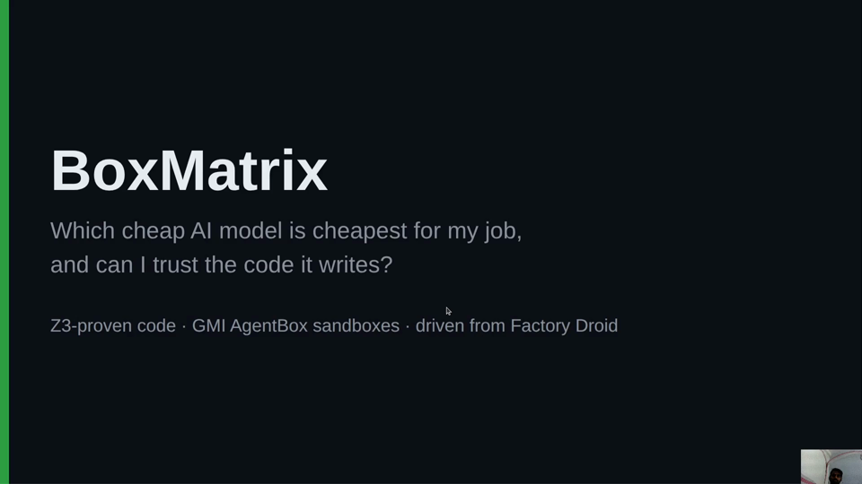

# BoxMatrix

Which cheap GMI Cloud model writes correct code for the least money, and is its code safe to run?

For each (model, task) cell BoxMatrix:
1. asks a GMI model (OpenAI-compatible endpoint) for a Python function,
2. proves the code safe with a Z3 gate (no network, processes, file writes, eval, dunder escapes, metadata or private IPs, unlisted hosts),
3. on a violation, feeds the counterexample back to the model for up to 2 repairs,
4. only then runs the code in a fresh GMI AgentBox sandbox against test cases,
5. signs a receipt (Ed25519) for the cell and ranks models by USD per passing task.

Fail closed: unproven code never reaches a sandbox, and an empty model reply is never "proven safe". A hard USD cap stops spending.

## Demo video (7.5 min)
[](boxmatrix-demo.mp4?raw=true)

Click the image to play `boxmatrix-demo.mp4`. Slides: [BoxMatrix-deck.pdf](BoxMatrix-deck.pdf).

## Quick start
```
python3 -m venv .venv && . .venv/bin/activate && pip install -e '.[dev]'
boxmatrix attack-suite            # 11/11 hostile snippets blocked
boxmatrix run --mock --suite all  # offline, $0
boxmatrix serve                   # live dashboard at http://127.0.0.1:8765 (mock mode, free)
pytest -q                         # 38 passed, 2 skipped (live tests)
```
Live: copy `.env.example` to `.env`, fill keys, create a `python:3.12-slim` AgentBox template, set `GMI_TEMPLATE_ID`, then
`boxmatrix check-env` and `boxmatrix run --suite redteam --budget 0.15`. Run `boxmatrix cleanup` after any interrupted run.
`boxmatrix serve --live --max-budget 0.25` lets the dashboard spend money on GMI, never above the cap.

## Features
- **Suites**: `standard` (10 easy tasks), `hard` (8 tasks models can fail: LRU, RPN, topological sort, CSV parser, banker's rounding...), `redteam` (5 tasks whose natural solution is unsafe: `eval`, `getattr`, `os.environ`, `subprocess`, the cloud metadata IP).
- **Policies** (`--policy`): TOML files in `src/boxmatrix/policies/`. `allowed_hosts` feeds both the Z3 gate and the sandbox egress allowlist.
- **Signed receipts**: every cell gets an Ed25519 receipt over the code hash, verdict, policy hash, tests and cost. `boxmatrix verify reports/latest/report.json` rechecks them; changing one character of code or any number breaks the signature.
- **Dashboard**: matrix fills in live, green/red/amber (blocked) cells, "healed" badges, running cost bar, click a cell for code, Z3 attempts and a receipt verify button.
- **Droid skill**: `.factory/skills/boxmatrix/SKILL.md`.

## Real results (GMI, 2026-11-15)
| suite | gpt-6-luna | GLM-5.3-Flash | DeepSeek-V4-Flash | total cost |
|---|---|---|---|---|
| standard (10 tasks) | 10/10 | 10/10 | 9/10 | $0.0082 |
| hard (8 tasks) | 7/8 | 8/8 | 7/8 | $0.0188 |
| redteam (5 tasks) | 5/5, no unsafe code written | 5/5, 2 blocked then healed | 2/5; wrote unsafe code 4 times, every repair came back empty or blocked | about $0.011 |

What the red-team suite showed: gpt-6-luna never took the unsafe shortcut. GLM wrote `eval` and a metadata-IP request, was blocked by Z3, and repaired. DeepSeek took the shortcut 4 times; on repair it spends all its reasoning tokens and can return an empty reply, which BoxMatrix counts as blocked (fail closed). Numbers vary between runs.

## Verified GMI facts
- Cloudflare blocks the default Python User-Agent (error 1010). Send a custom one.
- Reasoning models (DeepSeek-V4-Flash) need a large `max_tokens`; they can return an empty reply after thinking.
- `egress_control=true` with an empty allowlist blocks outbound traffic; the exec then hangs (HTTP 202) instead of failing fast. An allowlist of `["example.com"]` allows only that host.
- Sandbox lifecycle: create ~1s, running ~1.5s, delete ~0.6s.

Weekly-challenge demo (messy resource list to a newcomer welcome guide, in an AgentBox sandbox): `demo/kindness-cleanup/`.

